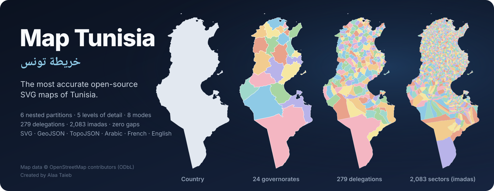
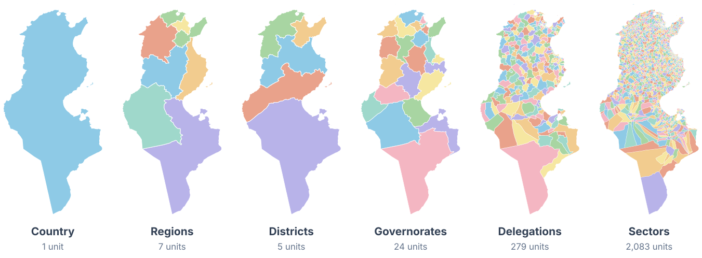
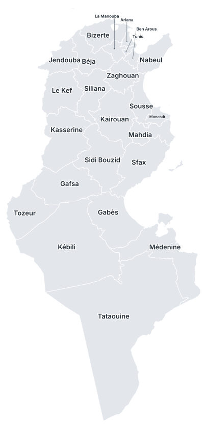
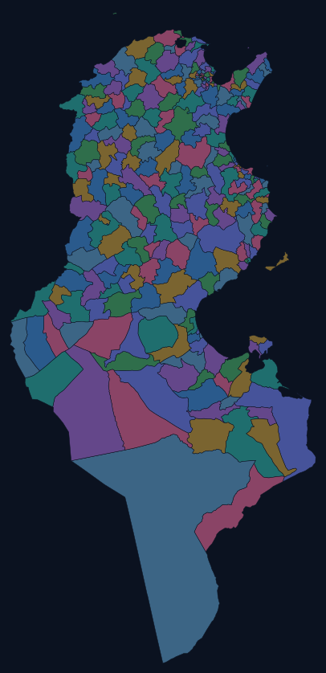
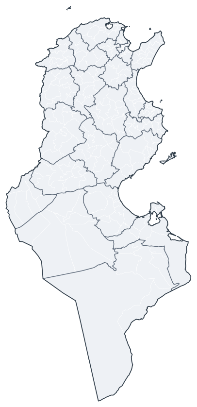

<div align="center">



<h3>The most accurate open-source SVG maps of Tunisia</h3>

<p>
Country · 7 economic regions · 5 districts · 24 governorates · 279 delegations · 2,083 imadas · 338 municipalities · 67 lakes, sebkhas &amp; lagoons · 284 cities<br>
5 levels of detail · 8 visual modes · SVG · GeoJSON · TopoJSON · العربية · Français · English
</p>

[](https://github.com/Alaa-Taieb/map-tunisia/actions/workflows/ci.yml)
[](docs/accuracy.md)
[](docs/reference.md#delegations)
[](docs/accuracy.md)
[](LICENSE)
[](LICENSE-DATA.md)

**[🧭 Live explorer](https://alaa-taieb.github.io/map-tunisia/)** ·
**[⬇️ Download](#-download)** ·
**[⚡ Quick start](#-quick-start)** ·
**[📚 Docs](docs/README.md)** ·
**[✅ Accuracy report](docs/accuracy.md)**

</div>

---

## Why Map Tunisia?

Most Tunisia SVGs online are hand-traced, outdated, missing islands, or stop at the 24 governorates. Map Tunisia is built
from **OpenStreetMap**, the most precise open source of Tunisian boundaries, and cross-checked against official INS and ISIE
lists. The result is a complete, exactly nested set of maps that you can drop into any project.

<table>
<tr>
<td width="33%" valign="top">

### 🎯 Accurate
- Real coastline at full precision, with **every island**: Djerba, Kerkennah, La Galite, Zembra, Kuriat…
- **0 km² of gaps or overlaps**: every level is cut from one planar topology
- Land area within **0.08 %** of the CIA World Factbook
- **[Every correction](docs/accuracy.md)** to the raw data is documented with its source

</td>
<td width="33%" valign="top">

### 🧩 Complete
- **6 nested partitions**, down to the 2,083 *imadas*
- **All 279 delegations** of the 2024 census, including the 14 created since 2014, which no other open dataset has
- The **2023 districts** (Decree 2023-589) and the **7 economic regions**
- **2014 & 2024 census population** built in

</td>
<td width="33%" valign="top">

### 🛠️ Ready to use
- **8 modes**: plain, outline, light, dark, Latin labels, Arabic labels, nested borders, interactive
- **5 levels of detail**, from 1 m precision to 17 KB icons
- Semantic ids (**ISO 3166-2**, **INS codes**) and `data-*` attributes in 3 languages
- GeoJSON + TopoJSON + CSV, a **lon/lat → SVG** helper, and an explorer

</td>
</tr>
</table>

## 🖼️ Gallery

**Six partitions, exactly nested**



**Eight modes**


**Five levels of detail** (Djerba, at the same zoom)


<details>
<summary><b>More examples</b>: labelled maps in both scripts, dark delegations, nested sectors</summary>
<br>
<table>
<tr>
<td align="center"><br><sub><code>governorates · medium · labeled</code></sub></td>
<td align="center"><br><sub><code>governorates · medium · labeled-ar</code></sub></td>
<td align="center"><br><sub><code>delegations · low · dark</code></sub></td>
<td align="center"><br><sub><code>delegations · medium · nested</code></sub></td>
</tr>
</table>
</details>

## ⚡ Quick start

**1. Use a file directly.** Every SVG scales to any size:

```html

```

**2. Inline it and style it with CSS.** Every shape has an `id` and `data-*` attributes:

```css
#TN-61 { fill: #ffb703; }                            /* Sfax, by ISO 3166-2 code */
.unit[data-region="sud-ouest"] { fill: #8ecae6; }    /* a whole economic region */
.unit:hover { fill: #e63946; }
```

**3. Add behaviour with a few lines of JavaScript:**

```js
document.querySelectorAll('.map-tunisia .unit').forEach((el) =>
  el.addEventListener('click', () =>
    alert(`${el.dataset.nameFr} · ${el.dataset.nameAr} — ${Number(el.dataset.population2024).toLocaleString()} inhabitants`)));
```

**4. Place your own points.** All SVGs share one frame (UTM 32N, 1 unit = 1 km):

```js
import { project } from 'https://cdn.jsdelivr.net/gh/Alaa-Taieb/map-tunisia@main/src/projection.js';
const [x, y] = project([10.7600, 34.7406]); // Sfax → SVG coordinates
svg.insertAdjacentHTML('beforeend', `<circle cx="${x}" cy="${y}" r="3" fill="crimson"/>`);
```

**More recipes** for React, D3 + TopoJSON, Leaflet, MapLibre, Python (GeoPandas, Plotly), R, QGIS, Figma, print and laser cutting are in the **[usage guide](docs/usage.md)**.

## ⬇️ Download

Every file lives in [`dist/`](dist/) and follows one naming scheme:

```text
dist/svg/<partition>/tunisia-<partition>-<lod>-<mode>.svg     191 SVG maps
dist/geojson/tunisia-<partition>-<lod>.geojson                WGS84, with all attributes
dist/topojson/tunisia-<partition>-<lod>.topojson              WGS84, shared borders
dist/data/<partition>.csv | .json                             names, codes, populations, areas, label points
```

| Popular file | Size |
| --- | ---: |
| [Governorates, labelled](dist/svg/governorates/tunisia-governorates-medium-labeled.svg) · [Arabic](dist/svg/governorates/tunisia-governorates-medium-labeled-ar.svg) | 135 KB |
| [Governorates, interactive](dist/svg/governorates/tunisia-governorates-medium-interactive.svg) | 135 KB |
| [Delegations, light](dist/svg/delegations/tunisia-delegations-medium-light.svg) | 446 KB |
| [Sectors (imadas), nested](dist/svg/sectors/tunisia-sectors-medium-nested.svg) | 1.8 MB |
| [Municipalities, light](dist/svg/municipalities/tunisia-municipalities-medium-light.svg) · [interactive](dist/svg/municipalities/tunisia-municipalities-medium-interactive.svg) | 506 KB |
| [Water bodies, light](dist/svg/water/tunisia-water-medium-light.svg) · [labelled](dist/svg/water/tunisia-water-medium-labeled.svg) | 103 KB |
| [Cities, labelled](dist/svg/cities/tunisia-cities-medium-labeled.svg) · [Arabic](dist/svg/cities/tunisia-cities-medium-labeled-ar.svg) | 253 KB |
| [Country outline, for icons](dist/svg/country/tunisia-country-tiny-plain.svg) | 4 KB |
| [Governorates TopoJSON](dist/topojson/tunisia-governorates-medium.topojson) · [GeoJSON](dist/geojson/tunisia-governorates-medium.geojson) | 105 KB · 306 KB |

Browse every combination in the **[file catalog](docs/catalog.md)** or the **[live explorer](https://alaa-taieb.github.io/map-tunisia/)**,
or grab everything with **[Download ZIP](https://github.com/Alaa-Taieb/map-tunisia/archive/refs/heads/main.zip)**.

### 📦 Install from npm

```bash
npm install map-tunisia
```

```js
import { svgPath, attributesPath, project, catalog } from 'map-tunisia';   // helpers (TypeScript types included)
import delegations from 'map-tunisia/data/delegations.json' with { type: 'json' };   // 279 rows, no fetch needed

delegations.length;                          // 279
catalog.partitions.map((p) => p.count);      // [1, 7, 5, 24, 279, 2083, 338, 67, 284]
svgPath('governorates', 'medium', 'light');  // 'dist/svg/governorates/tunisia-governorates-medium-light.svg'
```

The maps are plain files, so bundlers and servers can reach them through subpath exports:
`map-tunisia/svg/…`, `map-tunisia/geojson/…`, `map-tunisia/topojson/…` and `map-tunisia/data/…`
(for example `map-tunisia/geojson/tunisia-governorates-medium.geojson`). The package is large (about 46 MB packed, every
level of detail included); if you only need one file, use the CDN links above or a release ZIP below.
Full API: [docs/usage.md](docs/usage.md#13-the-npm-helper).

### 🗜️ Versioned release ZIPs

Each release ships one ZIP per format plus a checksum file, named after the package version:

| File | Contents |
| --- | --- |
| `map-tunisia-vX.Y.Z-geojson.zip` | GeoJSON, every partition and level of detail |
| `map-tunisia-vX.Y.Z-topojson.zip` | TopoJSON, every partition and level of detail |
| `map-tunisia-vX.Y.Z-json.zip` / `-csv.zip` | attribute tables (names, codes, populations, areas, label points) |
| `map-tunisia-vX.Y.Z-svg.zip` | all 191 SVG maps |
| `map-tunisia-vX.Y.Z-SHA256SUMS.txt` | checksums: `sha256sum -c map-tunisia-vX.Y.Z-SHA256SUMS.txt` |

Download them from the project's *Releases* page, or build them yourself from a clone: `npm install && npm run release:zip`
writes everything into `release/` (git-ignored). The archives are reproducible: same sources, same bytes.

## 📦 What's inside

### Partitions

| Partition | Units | | Description |
| --- | ---: | --- | --- |
| `country` | 1 | تونس | National outline with every island |
| `regions` | 7 | الأقاليم الاقتصادية | INS economic regions: Grand Tunis, Nord-Est, Nord-Ouest, Centre-Est, Centre-Ouest, Sud-Est, Sud-Ouest |
| `districts` | 5 | الأقاليم | The *aqalim* of Decree 2023-589 (National Council of Regions and Districts) |
| `governorates` | 24 | الولايات | The *wilayas*, with ids `TN-11` … `TN-83` (ISO 3166-2) |
| `delegations` | 279 | المعتمديات | The *mutamadiyat*, INS 2024 nomenclature |
| `sectors` | 2,083 | العمادات | The *imadas*, the finest administrative level |
| `municipalities` | 338 | البلديات | The *baladiyat*, a **separate layer that does not nest** in delegations ([below](#municipalities-baladiyat)) |
| `water` | 67 | المسطحات المائية | Lakes, dams, sebkhas, chotts and sea-side lagoons, an **overlay** that leaves the partitions above unchanged ([below](#water-lakes-sebkhas-and-lagoons)) |
| `cities` | 284 | المدن | **Points**: the capital Tunis, the 24 governorate capitals and the municipal seats ([below](#cities-and-capitals)) |

### Municipalities (*baladiyat*)

Municipal borders don't follow delegations or imadas, so the municipalities ship as their own partition: same file names,
`id`s and `data-*` attributes as the other layers, in SVG (`full` to `low`, every mode except `nested`), GeoJSON, TopoJSON,
CSV and JSON. Each one carries its Arabic, French and English names, its governorate (plus region and district), its area,
its OSM relation and a label point. Ids look like `municipality-7286094` (Zarzis), after the OSM relation.

```js
import municipalities from 'map-tunisia/data/municipalities.json' with { type: 'json' };
import { svgPath } from 'map-tunisia';

municipalities.length;                                   // 338
municipalities.filter((m) => m.governorate === 'TN-82'); // the 10 municipalities of Médenine
svgPath('municipalities', 'medium', 'interactive');      // 'dist/svg/municipalities/tunisia-municipalities-medium-interactive.svg'
```

```css
.municipality[data-governorate="TN-82"] { fill: #219ebc; }   /* one governorate's municipalities */
#municipalities-base { fill: #eceff3; }                      /* land outside every mapped municipality */
```

**Source:** the OpenStreetMap relations tagged `boundary=municipality` (© OpenStreetMap contributors, ODbL 1.0), from the
same extract as the other layers, clipped to the land. No geometry is invented: OSM maps 338 of the 350 municipalities of
the 2016 division, so 2.1 % of the land (some sebkhas, and areas not yet mapped) stays outside every municipality and is drawn
as a light base under the units. Coverage, the gaps and the OSM relations whose names look wrong are in the
[accuracy report](docs/accuracy.md#municipalities-baladiyat).

### Water: lakes, sebkhas and lagoons



The `water` layer draws the **67 named water bodies of at least 1 km²** over the land: 6 lakes (Ichkeul…), 18 dam reservoirs
(Sidi Salem, Sidi El Barrak…), 35 sebkhas (Sidi El Hani, Kelbia, Sejoumi…), the 3 chotts (el-Jérid, el-Fejej, el-Gharsa) and
5 sea-side lagoons (Bizerte, Ghar El Melh, the two Lakes of Tunis, El Bibane). It is an **overlay**: the governorates,
delegations and sectors keep the inland water inside them, so their areas and the zero-gap guarantee do not change, and the
lagoons lie on the sea side of the coastline. Same naming scheme as every layer: SVG (`full` to `low`, every mode except
`nested`), GeoJSON, TopoJSON, CSV and JSON. In the `light`, `dark` and `interactive` modes open water is blue and salt flats
are sand-coloured.

Each body carries its `type` (`lake`, `reservoir`, `sebkha`, `chott` or `lagoon`), its names in Arabic, French and English,
its main `governorate` and every governorate it touches (`governorates`), its area, `salt` and `intermittent` flags, and its
OSM way or relation. Ids follow the OSM element: `water-r3969167` (Chott el-Jérid, relation 3969167), `water-w49730150`
(Sebkhet Ariana, way 49730150); the two lagoons cut from the coastline are `water-bizerte` and `water-el-bibane`.

```js
import water from 'map-tunisia/data/water.json' with { type: 'json' };

water.filter((w) => w.type === 'lagoon').map((w) => w.name_fr);
// ['Lac de Bizerte', 'Bahiret el Bibane', 'Lagune de Ghar El Melh', 'Lac de Tunis', 'Lac Sud de Tunis']
```

```css
.water-body[data-type="sebkha"], .water-body[data-type="chott"] { fill: #eadfc4; }
.water-body[data-salt="yes"][data-intermittent="yes"] { fill-opacity: .7; }   /* seasonal salt lakes */
#water-base { fill: none; }                                                  /* drop the land, overlay on your own map */
```

**Source:** OpenStreetMap water areas (`natural=water` lakes, reservoirs and salt lakes, and salt wetlands; rivers, ponds and
salt pans are left out), clipped to the land. OSM has no polygon for the Bizerte and El Bibane lagoons, so they are cut from
the OSM coastline: the parts of the sea that open to it through a channel narrower than 600 m. Unnamed areas and areas under
1 km² are left out. Every merge, clip and gap is in the [accuracy report](docs/accuracy.md#water-bodies).
<br clear="right">

### Cities and capitals



The `cities` layer is a **point layer**: the capital **Tunis**, the other **23 governorate capitals** and **260 more
municipal seats**, 284 points in all. Each point has its `type` (`national_capital`, `governorate_capital` or `city`),
`capital_of` (`TN TN-11` for Tunis, `TN-61` for Sfax…), its names in Arabic, French and English, its governorate, delegation,
sector and municipality, its `lon`/`lat`, and its `x`/`y` in the shared SVG frame. The SVGs (`full` to `low`, every mode
except `nested`) draw the dots over the land and the governorate borders, sized and coloured by type; the labelled modes
name every capital and as many other cities as fit (the `low` level names the capitals only). Ids follow the OSM node:
`city-n27564968` is Tunis.

```js
import cities from 'map-tunisia/data/cities.json' with { type: 'json' };
import { project } from 'map-tunisia';

const capitals = cities.filter((c) => c.type !== 'city');      // 24: Tunis and the 23 other governorate capitals
const sfax = cities.find((c) => c.capital_of === 'TN-61');
project([Number(sfax.lon), Number(sfax.lat)]);                   // [x, y] on any Map Tunisia SVG, equal to sfax.x / sfax.y
```

**Source:** OpenStreetMap only. Tunis is the `admin_centre` of the country relation (tagged `capital=yes`), each governorate
capital is the `admin_centre` of its governorate relation, and a municipal seat is the `admin_centre` of its municipality or
the settlement node of the same name inside it. No point is typed in by hand: 56 of the 338 OSM municipalities have no such
node (and 12 municipalities are not in OSM at all, Sfax and Sidi Bouzid among them), so they have no seat point; the list is
in the [accuracy report](docs/accuracy.md#cities). There is no population threshold: OSM population tags are too sparse.
<br clear="right">

### Levels of detail

| Level | Tolerance | Use it for | Governorates file |
| --- | ---: | --- | ---: |
| `full` | none (OSM precision) | GIS, print, deep zoom | 1.3 MB |
| `high` | ≈ 20 m | posters, zoomable maps | 390 KB |
| `medium` | ≈ 100 m | **websites, dashboards, slides** | 135 KB |
| `low` | ≈ 500 m | small embeds, mobile | 37 KB |
| `tiny` | ≈ 2.5 km | icons, thumbnails | 17 KB |

### Modes

| Mode | | Mode | |
| --- | --- | --- | --- |
| `plain` | neutral, ready for your CSS | `labeled` | names in Latin script, callouts where crowded |
| `outline` | strokes only: print, laser, overlays | `labeled-ar` | names in Arabic, right-to-left |
| `light` | colourful, neighbours never share a colour | `nested` | higher-level borders drawn heavier |
| `dark` | for dark UIs | `interactive` | hover + tooltips, no JavaScript |

Details and guidance: **[partitions, levels & modes](docs/partitions-levels-modes.md)** · every id and attribute: **[data dictionary](docs/data-dictionary.md)**.

## ✅ Accuracy

Map Tunisia starts from OpenStreetMap and fixes what raw OSM gets wrong. Everything is reproducible and documented in the
**[accuracy report](docs/accuracy.md)**, regenerated with every build.

| | Raw OpenStreetMap | Map Tunisia |
| --- | --- | --- |
| Delegations | 264 + a stale duplicate (2014 nomenclature) | **279**, matching the INS 2024 list code by code |
| Nesting | levels drawn independently; lakes missing from delegations | **one planar topology**: 0 gaps, 0 overlaps |
| Kébili and Jendouba | 10 sectors in the wrong delegation | reassigned, checked against INS codes and ISIE maps |
| Names | rotated or duplicated names, typos, invisible characters | 24 names corrected; Unicode normalised |
| Country polygon | includes the 12-NM territorial sea | land only, following the coastline |
| Islets | 63 mapped only as coastline | included |

How it works: all boundaries are noded into one set of faces, conflicts are resolved by documented rules, inland lakes are
split by nearest-boundary allocation, and post-2014 delegations are rebuilt from their imadas using the electoral authority's
(ISIE) official lists. Then mapshaper simplifies with topology preserved. Read the **[methodology](docs/methodology.md)**.

## 🧭 One frame, real kilometres

Every SVG uses the same `viewBox="0 0 406 838"` in **WGS 84 / UTM zone 32N** with **1 unit = 1 km**. Files of different
partitions overlay perfectly, distances can be read straight off the map, and the dependency-free
[`project()`](src/projection.js) helper (tested to < 1 mm against PROJ) places any longitude/latitude.
See **[projection & coordinates](docs/projection.md)**.

## 🛠️ Build from source

```bash
npm install
npm run build        # dist/ from data/ in ~30 s
npm test             # 249 checks: counts, ids, nesting, areas, populations, water, cities, XML validity, sizes, projection, package + ZIPs
npm run release:zip  # versioned ZIPs + SHA256SUMS into release/

# refresh from the latest OpenStreetMap data (Python 3.10+)
pip install -r scripts/extract/requirements.txt
npm run fetch && npm run extract && npm run extract:municipalities && npm run extract:water && npm run extract:cities && npm run build
```

The pipeline: **pyosmium + Shapely** (extraction and topology) → **mapshaper** (dissolve, projection, simplification) →
a custom SVG writer (labels with polylabel, map colouring, accessible markup). See [CONTRIBUTING.md](CONTRIBUTING.md#project-layout).

## 🗺️ Roadmap

- [x] 6 nested partitions, 5 levels of detail, 8 modes
- [x] All 279 delegations of the 2024 nomenclature
- [x] GeoJSON / TopoJSON / CSV, projection helper, live explorer
- [x] Municipalities (*baladiyat*) as a separate, non-nested partition
- [x] Optional water layer: lagoons, sebkhas, chotts and dams
- [x] Cities and capitals as point layers
- [ ] Tamazight (Tifinagh) and English-transliteration label modes
- [x] npm package (types, JSON data exports) and versioned release ZIPs with checksums

Ideas and votes are welcome in the [issues](https://github.com/Alaa-Taieb/map-tunisia/issues).

## 🤝 Contributing

Spotted a wrong border, name or code? **[Report a data error](https://github.com/Alaa-Taieb/map-tunisia/issues/new?template=data-error.yml)**.
It's the most valuable contribution you can make. Code, docs and new modes are welcome too: see [CONTRIBUTING.md](CONTRIBUTING.md) and
the [Code of Conduct](CODE_OF_CONDUCT.md).

## 📜 License & attribution

- **Code** (scripts, `src/`, explorer, tests): [MIT](LICENSE)
- **Maps and data** (`dist/`, `data/`, illustrations): [ODbL 1.0](LICENSE-DATA.md), derived from OpenStreetMap

When you use the maps, please credit:

> Map data © [OpenStreetMap contributors](https://www.openstreetmap.org/copyright) · [Map Tunisia](https://github.com/Alaa-Taieb/map-tunisia) by Alaa Taieb

Using Map Tunisia in research? See [CITATION.cff](CITATION.cff) (GitHub's *Cite this repository* button).

## 👤 Author

<table>
<tr>
<td align="center" width="140">
<a href="https://github.com/Alaa-Taieb"><br><b>Alaa Taieb</b></a><br>
<sub>Creator & maintainer</sub>
</td>
<td>

**Map Tunisia** is created and maintained by **[Alaa Taieb](https://github.com/Alaa-Taieb)**.

If this project helps you, please ⭐ **star the repository**, share it, and credit it when you publish a map.
It helps others find it.

</td>
</tr>
</table>

### Acknowledgements

- The thousands of **[OpenStreetMap](https://www.openstreetmap.org) contributors** who mapped Tunisia's boundaries, municipalities, towns, lakes, sebkhas and coastline
- **Institut National de la Statistique** (INS) for the geocodes and census figures, and the **ISIE** for its public circonscription maps
- [Geofabrik](https://download.geofabrik.de) for the daily extracts
- [mapshaper](https://github.com/mbloch/mapshaper), [pyosmium](https://osmcode.org/pyosmium/), [Shapely](https://shapely.readthedocs.io),
  [pyproj](https://pyproj4.github.io/pyproj/) and [polylabel](https://github.com/mapbox/polylabel), the open-source tools this project stands on

<div align="center">
<br>
<sub>Made with ❤️ for Tunisia 🇹🇳 · صُنع بحبّ لتونس</sub>
</div>
