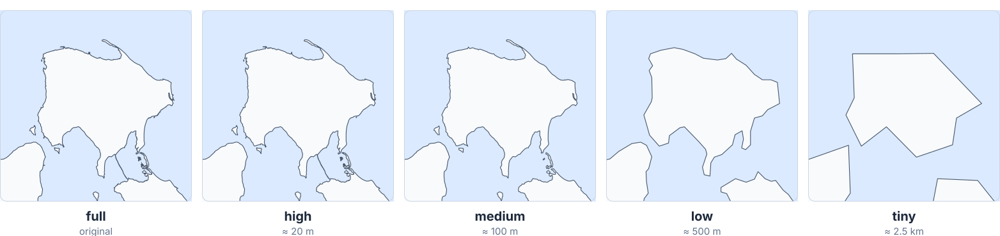
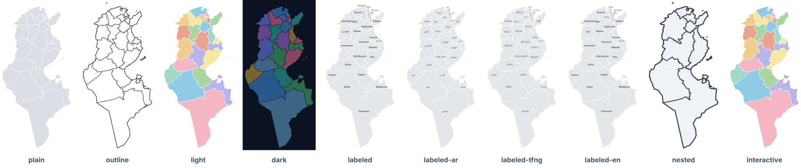

# Partitions, levels of detail & modes

Each map is one combination of three choices:

```text
dist/svg/<partition>/tunisia-<partition>-<lod>-<mode>.svg
          │                     │      └── how it looks (8 modes)
          │                     └───────── how detailed it is (5 levels)
          └─────────────────────────────── how Tunisia is divided (6 nested partitions + municipalities + water + cities)
```

## Partitions

The six administrative partitions are **exactly nested**: every sector lies in one delegation, every delegation in one governorate, and every
governorate in one region and one district. Shared borders are identical at every level, with zero gaps and zero overlaps.

| Partition | Units | Arabic | What it is | Typical use |
| --- | ---: | --- | --- | --- |
| `country` | 1 | تونس | National outline: mainland plus every island (Djerba, Kerkennah, La Galite, Zembra, Kuriat…). | Logos, locators, backgrounds |
| `regions` | 7 | الأقاليم الاقتصادية | Economic regions used by the INS and planning ministries: Grand Tunis, Nord-Est, Nord-Ouest, Centre-Est, Centre-Ouest, Sud-Est, Sud-Ouest. | Regional statistics, development indicators |
| `districts` | 5 | الأقاليم | The *aqalim* created by Decree 2023-589 (21 Sept 2023), the constituencies of the National Council of Regions and Districts. | Elections, institutional maps |
| `governorates` | 24 | الولايات | The 24 *wilayas*, identified by their ISO 3166-2 code (`TN-11` … `TN-83`). | The classic map of Tunisia |
| `delegations` | 279 | المعتمديات | The *mutamadiyat* of the INS 2024 nomenclature, including the 14 created since 2014. | Census and election results, local data |
| `sectors` | 2,083 | العمادات | The *imadas*: the finest administrative level, coded by the INS. | Fine-grained analysis, field operations |
| `municipalities` | 338 | البلديات | The *baladiyat* of the 2016 division as mapped in OpenStreetMap (`boundary=municipality`). **Not nested**: see below. | Municipal services, local elections, urban data |

### Municipalities are a separate layer

Municipal borders do not follow delegation or sector borders (20 municipalities spread over several delegations), so
`municipalities` is built from its own source layer and has no `nested` mode. Each municipality is attached to the
governorate that holds most of its area. OSM maps 338 of the 350 municipalities; 2.1 % of the land lies outside every
mapped municipality and is drawn as a light grey base (`#municipalities-base`) under the units, so it is never mistaken for
sea. The [accuracy report](accuracy.md#municipalities-baladiyat) lists those areas.

### Water is an overlay

`water` (المسطحات المائية) holds the 67 named lakes, dam reservoirs, sebkhas, chotts and sea-side lagoons of at least 1 km².
It is not a division of the land: lakes, sebkhas and chotts stay inside the governorates, delegations and sectors that
contain them (their areas include them), and the lagoons of Bizerte, Ghar El Melh and El Bibane lie on the sea side of the
coastline. Stack a `water` SVG over any other partition (they share one frame), or use it alone: every file draws the land
as a light base (`#water-base`) under the water. In `light`, `dark` and `interactive`, colours follow the body's `type`
(blue for lakes, reservoirs and lagoons, sand for sebkhas and chotts). Like the municipalities it has no `nested` mode and
stops at `low`. The [accuracy report](accuracy.md#water-bodies) lists what was merged, clipped and left out.

### Cities are points

`cities` (المدن) is the only point layer: 284 dots for the capital Tunis, the 23 other governorate capitals and the seats of
the municipalities that OpenStreetMap supports. Every file draws the land (`#cities-base`) and the governorate borders
(`#borders`) under the dots, which are `<circle>` elements sized and coloured by `type` (red for Tunis, blue for the
governorate capitals, slate for the other cities). The level of detail changes the land and borders, not the points; the
labelled modes name every capital and as many other cities as fit without overlaps, and at `low` they name the capitals
only. Like water, it has no `nested` mode and stops at `low`. The
[accuracy report](accuracy.md#cities) lists the municipalities without a seat point.

See the [reference tables](reference.md) for every region, district, governorate and delegation.

## Levels of detail (LOD)

Simplification is **topology-aware** (mapshaper, Visvalingam). Neighbouring shapes stay glued together and every unit keeps
at least its basic shape, even the smallest urban sectors. Tolerances are in real metres on the ground.



| Level | Tolerance | Coordinates | Best for | Example: governorates, `plain` |
| --- | ---: | ---: | --- | ---: |
| `full` | none | 1 m | GIS, print at any size, deep zoom | 1.3 MB |
| `high` | ≈ 20 m | 10 m | large prints, zoomable web maps | 390 KB |
| `medium` | ≈ 100 m | 10 m | **default** for websites, dashboards and slides | 135 KB |
| `low` | ≈ 500 m | 100 m | small embeds, mobile, social cards | 38 KB |
| `tiny` | ≈ 2.5 km | 100 m | icons, favicons, thumbnails | 17 KB |

At `medium` and below, tiny secondary islets are dropped (`medium` < 0.02 km², `low` < 0.5 km², `tiny` < 5 km²). Each
unit's main part is always kept. The [accuracy report](accuracy.md#levels-of-detail-shape-fidelity) shows how area and
vertex counts change, and the [catalog](catalog.md) lists every file size.

**Which partitions exist at which level?** `country`, `regions`, `districts` and `governorates` exist at all five levels.
`delegations`, `sectors`, `municipalities`, `water` and `cities` stop at `low`: at `tiny`, a city delegation would shrink to a few pixels anyway.

## Modes



| Mode | Looks like | Notes |
| --- | --- | --- |
| `plain` | neutral grey fills, white borders | the best base for your own CSS; available at every level |
| `outline` | strokes only, no fill, plus a heavier country outline | line art: print, plotters, laser cutters, overlays |
| `light` | colourful fills on a transparent background | map colouring: neighbours never share a colour |
| `dark` | deep colours on a dark background | made for dark UIs |
| `labeled` | plain map + Latin-script names (French spelling) | labels sit at each unit's visual centre; crowded areas such as Grand Tunis get callouts with leader lines |
| `labeled-ar` | plain map + Arabic names | right-to-left; laid out separately from the Latin labels (Arabic text has different widths) |
| `nested` | light fills, the partition's borders thin, higher-level borders heavier | e.g. sectors with their delegation and governorate borders; not for partitions without a parent |
| `interactive` | `light` + hover highlight + native tooltips | pure SVG + CSS, no JavaScript; works when inlined or opened directly |

Modes are available at `medium`, `low` and `tiny`; `full` and `high` offer `plain`, `outline` and `nested` (restyle `plain`
with CSS to get any look at full detail).

### Labels

- Labels use the unit's **pole of inaccessibility**, the point inside the shape farthest from its edges. That makes them
  readable even in crescent-shaped or coastal units. The same point is published as `label_lon` / `label_lat` in
  `dist/data/*.csv`, ready for your own labels.
- Font sizes adapt to each unit. Labels that don't fit are shrunk, nudged, or (for the 4 coarser partitions) placed as a
  callout in the sea with a leader line.
- City labels sit next to their dot, at one of eight positions around it. Capitals are placed first and may move further
  out with a leader line; a city whose label would overlap another goes unlabelled.
- Fonts: the SVGs ask for Inter / Segoe UI / Helvetica / Arial (Latin) and Noto Naskh Arabic / Segoe UI / Tahoma (Arabic),
  falling back to the system's sans-serif font.

## Choosing quickly

| I need… | Use |
| --- | --- |
| a map of Tunisia for a slide or a blog post | `governorates` · `medium` · `light` or `labeled` |
| a hoverable map in a web page without writing code | any partition · `medium` · `interactive` (inline it) |
| to colour regions from my spreadsheet | `governorates` or `delegations` · `medium` · `plain` + [a few lines of JS](usage.md#4-choropleth-from-your-own-data) |
| a background map for a web map library | `dist/geojson/` · `high` |
| an icon or favicon | `country` · `tiny` · `plain` |
| a poster | any partition · `high` · `nested` or `plain` |
| to cut Tunisia out of wood or acrylic | `country` · `high` · `outline` |
